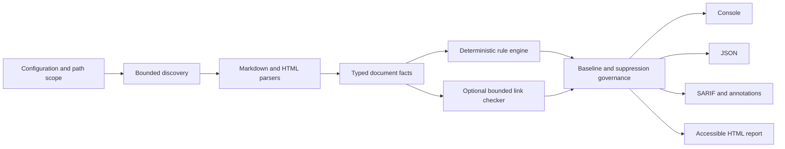

# Documentation Quality Gate

[](https://github.com/JasonStys/documentation-quality-gate/actions/workflows/ci.yml)
[](https://github.com/JasonStys/documentation-quality-gate/actions/workflows/documentation-quality.yml)
[](https://github.com/JasonStys/documentation-quality-gate/actions/workflows/codeql.yml)
[](https://nodejs.org/)

A deterministic TypeScript CLI and JavaScript GitHub Action for technical-documentation repositories. It turns Markdown and HTML into typed facts, runs high-signal rules, resolves local references, optionally checks public links with bounded network access, emits exact remediation, and publishes console, JSON, SARIF, HTML, and workflow-annotation evidence.

The design goal is adoption: stable rule IDs, precise locations, secure defaults, expiring suppressions, baseline protection, and reports that serve authors, reviewers, and program metrics without executing documentation code.

## 60-second quick start

Requirements: Node.js 22 or newer and pnpm 11.

```bash
corepack enable
pnpm install --frozen-lockfile
pnpm build
node dist/lib/cli.js examples/valid --config examples/valid/.docquality.json
```

The command prints a compiler-style summary and writes these files under `reports/documentation-quality/`:

- `documentation-quality.json` for dashboards and automation.
- `documentation-quality.sarif` for GitHub code scanning.
- `documentation-quality.html` for reviewers and downloadable evidence.

Use the Action after publishing a versioned release:

```yaml
permissions:
  contents: read
  security-events: write

steps:
  - uses: actions/checkout@v7
  - uses: JasonStys/documentation-quality-gate@v1
    with:
      config: .docquality.json
      changed-from: origin/main
      output-directory: reports/documentation-quality
  - if: always()
    uses: github/codeql-action/upload-sarif@v4
    with:
      sarif_file: reports/documentation-quality/documentation-quality.sarif
```

Pin third-party Actions to a reviewed commit SHA in higher-risk environments.

## Why this project is useful

Documentation failures are often semantic rather than cosmetic: the wrong firmware version, an unreachable procedure, an image without a text alternative, a warning without a consequence, or a duplicate identifier. Generic linters can produce noise without explaining operational impact. This project gives each finding a stable contract:

```json
{
  "ruleId": "DQ005",
  "severity": "error",
  "message": "Local link anchor does not exist: #safe-start",
  "remediation": "Use an existing heading or element ID; anchor matching is case-sensitive.",
  "file": "docs/commissioning.md",
  "location": { "line": 42, "column": 1 },
  "fingerprint": "stable SHA-256 value",
  "suppressed": false
}
```

## Features

- Parses Markdown/GFM and HTML into one document-fact model.
- Checks metadata, headings, images, local links and anchors, schemes, tables, examples, warnings, HTML landmarks, identifiers, and versions.
- Validates JSON examples without running arbitrary code.
- Makes external-link checks opt-in, cached, retried, rate-bounded, and private-host blocked by default.
- Supports severity gates, changed-file mode, explicit baselines, path/line suppressions, rationales, and expiry.
- Produces GitHub annotations and SARIF with deterministic fingerprints.
- Runs on Windows and Linux with Node.js 22 and 24.
- Dogfoods the packaged Action against this repository and publishes evidence artifacts.

## Built-in rule summary

| Rule    | Default | Purpose                                                           |
| ------- | ------- | ----------------------------------------------------------------- |
| `DQ000` | Error   | Reject expired suppressions.                                      |
| `DQ001` | Error   | Require configured metadata.                                      |
| `DQ002` | Warning | Prevent skipped heading levels.                                   |
| `DQ003` | Warning | Prevent duplicate generated heading anchors.                      |
| `DQ004` | Error   | Require image alternatives.                                       |
| `DQ005` | Error   | Resolve local files and fragments.                                |
| `DQ006` | Error   | Reject active/unsupported schemes and flag avoidable HTTP.        |
| `DQ007` | Warning | Require non-empty table headers.                                  |
| `DQ008` | Warning | Require code languages and parse JSON examples.                   |
| `DQ009` | Error   | Require condition, consequence, and avoidance in warnings.        |
| `DQ010` | Error   | Require HTML language, title, one main landmark, and unique IDs.  |
| `DQ011` | Error   | Require unique document IDs and semantic versions when present.   |
| `DQ012` | Warning | Classify optional external-link health checks.                    |
| `DQ013` | Error   | Convert bounded input/parse failures into actionable diagnostics. |

See the [complete rule catalog](docs/rules.md) for examples and remediation.

## Configuration

```json
{
  "$schema": "./schemas/config.schema.json",
  "include": ["README.md", "docs/**/*.md", "site/**/*.html"],
  "exclude": ["docs/generated/**"],
  "failOn": "error",
  "requiredMetadata": ["title", "id", "version"],
  "externalLinks": {
    "enabled": false,
    "timeoutMs": 4000,
    "retries": 1,
    "concurrency": 4,
    "cacheTtlHours": 24,
    "allowPrivateHosts": false
  },
  "suppressions": [
    {
      "ruleId": "DQ004",
      "path": "docs/legacy/**",
      "rationale": "Diagram replacement is tracked for the migration release.",
      "expires": "2027-01-31"
    }
  ]
}
```

The full contract and changed-file guidance are in [docs/configuration.md](docs/configuration.md).

## Architecture



Parsing, rule evaluation, governance, and presentation are separate. Rules never write source files, reporters never reinterpret content, and optional network checks cannot target private addresses unless a trusted operator explicitly enables them. See [docs/architecture.md](docs/architecture.md).

## Baselines and suppressions

Generate a baseline only after review:

```bash
node dist/lib/cli.js . --write-baseline
```

The baseline records exact fingerprints for current findings. New findings remain visible. Prefer fixing issues; when an exception is necessary, use a narrow rule/path/line suppression with an owner-readable rationale and expiry. Expired suppressions fail with `DQ000`.

## Commands

| Command                 | Purpose                                                 |
| ----------------------- | ------------------------------------------------------- |
| `pnpm format:check`     | Verify deterministic formatting.                        |
| `pnpm lint`             | Run strict type-aware ESLint.                           |
| `pnpm typecheck`        | Compile-check source and tests without emitting.        |
| `pnpm test`             | Run all tests with enforced coverage.                   |
| `pnpm test:integration` | Run filesystem, HTTP, and scanner boundary tests.       |
| `pnpm build`            | Compile the CLI/library and bundle the Node 24 Action.  |
| `pnpm dogfood`          | Validate the representative example corpus.             |
| `pnpm benchmark`        | Measure complete scans at 100, 1,000, and 10,000 pages. |
| `pnpm verify`           | Run the complete local quality gate.                    |
| `pnpm pack:artifact`    | Produce the installable npm tarball.                    |

## Repository map

| Path                                          | Summary                                                                                                     |
| --------------------------------------------- | ----------------------------------------------------------------------------------------------------------- |
| `.github/workflows/ci.yml`                    | Cross-platform Node 22/24 verification, packaging, and evidence upload.                                     |
| `.github/workflows/documentation-quality.yml` | Runs this repository's own bundled Action and uploads SARIF/report artifacts.                               |
| `.github/workflows/codeql.yml`                | JavaScript/TypeScript security analysis.                                                                    |
| `.github/codeql.yml`                          | Analysis scope: excludes generated duplicate bundles, retains authored code.                                |
| `docs/reports/actions-review-2026-10-14.md`   | Evidence-based alert triage, dependency fixes and validation results.                                       |
| `.github/dependabot.yml`                      | Weekly npm and Actions dependency review.                                                                   |
| `action.yml`                                  | Node 24 Action inputs, outputs, branding, and entry point.                                                  |
| `src/action.ts`                               | Workflow annotations, step summary, report outputs, and failure policy.                                     |
| `src/cli.ts`                                  | CLI options, scanning, report generation, and baseline creation.                                            |
| `src/config.ts`                               | Strict JSON configuration parsing and safe defaults.                                                        |
| `src/diagnostics.ts`                          | Immutable diagnostic construction and fingerprints.                                                         |
| `src/discovery.ts`                            | Glob discovery, path scoping, and safe argument-array Git changed-file selection.                           |
| `src/external-links.ts`                       | Optional DNS-aware, cached, retrying, bounded HTTP checks.                                                  |
| `src/governance.ts`                           | Baselines, scoped suppressions, rationales, and expiry enforcement.                                         |
| `src/model.ts`                                | Shared configuration, fact, diagnostic, and report types.                                                   |
| `src/parsers/markdown.ts`                     | Markdown/GFM/front-matter fact extraction.                                                                  |
| `src/parsers/html.ts`                         | HTML structure and static accessibility fact extraction.                                                    |
| `src/rules.ts`                                | Rule catalog and deterministic evaluation.                                                                  |
| `src/reporters.ts`                            | Console, JSON, SARIF, and escaped self-contained HTML reports.                                              |
| `src/scanner.ts`                              | Bounded orchestration, parse-failure conversion, summaries, and thresholds.                                 |
| `scripts/build-action.mjs`                    | Bundles the Action and dependencies into `dist/index.cjs`.                                                  |
| `scripts/benchmark.ts`                        | Generates and scans 100/1,000/10,000-page corpora.                                                          |
| `scripts/clean.mjs`                           | Cross-platform generated-output cleanup.                                                                    |
| `scripts/verify-package.mjs`                  | Verifies required consumer artifacts.                                                                       |
| `schemas/config.schema.json`                  | Editor-friendly configuration JSON Schema.                                                                  |
| `schemas/report.schema.json`                  | Versioned JSON report contract.                                                                             |
| `examples/valid/`                             | Passing Markdown/HTML corpus and configuration.                                                             |
| `tests/unit/`                                 | Fast parser, rule, governance, configuration, and reporter tests.                                           |
| `tests/integration/`                          | Local HTTP, cache, retry, discovery, filesystem, and end-to-end scanner tests.                              |
| `docs/`                                       | Architecture, configuration, security, operations, development, testing, decisions, code map, and evidence. |

Generated `dist/` is committed because JavaScript Actions must provide a runnable bundle. The Action uses CommonJS for compatibility with the current `@actions/core` dependency graph while the CLI/library remain ESM. Coverage, reports, caches, benchmark fixtures, and package tarballs are not committed.

## Security and limitations

- Arbitrary documentation code is never executed. JSON examples are parsed only.
- Network checks are disabled by default and reject credential-bearing, local, private, and reserved targets.
- DNS preflight reduces server-side request-forgery exposure but cannot eliminate every DNS-rebinding risk; use a restricted runner when scanning untrusted documents with networking enabled.
- Static HTML checks complement rather than replace keyboard, screen-reader, reflow, contrast, and browser automation testing.
- Markdown anchor generation intentionally targets common GitHub behavior but is not a complete renderer emulator.

See [SECURITY.md](SECURITY.md), [docs/security.md](docs/security.md), and [docs/operations.md](docs/operations.md).

## Documentation

- [Architecture](docs/architecture.md)
- [Configuration reference](docs/configuration.md)
- [Rule catalog](docs/rules.md)
- [Testing strategy](docs/testing.md)
- [Security and threat model](docs/security.md)
- [Operations runbook](docs/operations.md)
- [Development guide](docs/development.md)
- [Code map and declaration locations](docs/code-map.md)
- [Architecture decision records](docs/adr/0001-deterministic-fact-model.md)
- [Verification evidence](docs/reports/verification.md)
- [Benchmark evidence](docs/reports/benchmark.md)
- [Latest maintenance audit](docs/reports/maintenance-audit-2026-09-18.md)

## License

MIT — see [LICENSE](LICENSE).
