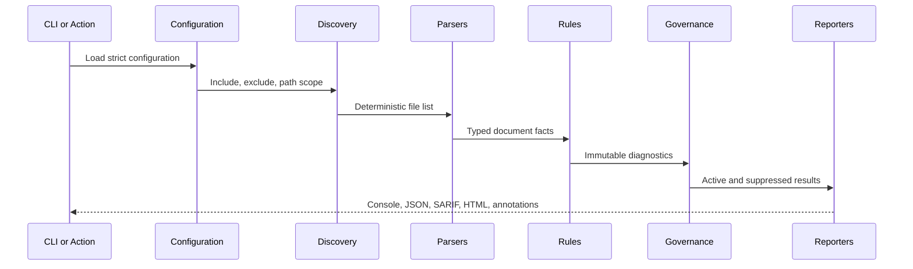

# Architecture

## Context and goals

The system validates technical documentation in local development and pull-request workflows. It must produce repeatable results, locate issues precisely, preserve developer trust, scale to large static content estates, and remain safe when repository content is untrusted.

## Component model

| Component       | Responsibility                                                               | Boundary                                                                     |
| --------------- | ---------------------------------------------------------------------------- | ---------------------------------------------------------------------------- |
| Configuration   | Validate path, policy, network, and exception settings.                      | Untrusted JSON becomes a typed immutable contract.                           |
| Discovery       | Expand globs, restrict scopes, and filter Git changes.                       | Symlinks are not followed; Git receives argument arrays, not a shell string. |
| Parsers         | Convert Markdown/GFM/YAML and HTML into document facts.                      | Individual inputs are limited to 5 MiB.                                      |
| Rules           | Evaluate deterministic facts and cross-document identity/link relationships. | Rules do not mutate sources or run examples.                                 |
| Network checker | Classify optional public links with bounded concurrency and cache.           | Disabled by default; credentials and private targets are blocked.            |
| Governance      | Apply exact baselines and reviewed suppressions.                             | Expiry is enforced and new fingerprints remain active.                       |
| Reporters       | Render console, JSON, SARIF, HTML, and Action annotations.                   | All HTML content is escaped and reporters do not re-evaluate rules.          |

## Data flow

## Failure behavior

- An invalid configuration stops before scanning and returns exit code 2 from the CLI.
- An unreadable, oversized, or syntactically invalid document becomes a `DQ013` diagnostic so reports remain complete.
- A missing Git base revision stops changed-file mode with a direct remediation message.
- A definite external 4xx response becomes a warning; timeout, rate limit, 5xx, and transport failures become notices after bounded retry.
- Report generation happens before the Action applies failure policy, which keeps evidence available on failed runs.

## Complexity and resource bounds

Let `F` be discovered files, `N` the total parsed nodes, `L` local links, and `E` unique external URLs.

- Discovery is approximately `O(F)` after glob traversal.
- Parsing and document rules are `O(N)`.
- Local document lookup is `O(L)` average using a map and anchor sets.
- Identifier grouping is `O(F)` average.
- Network work is `O(E)` with configurable concurrency capped at 16 and retries capped at 3.
- Parser concurrency is fixed at eight to bound open files and memory.

## Deployment

The npm package exposes `dist/lib/cli.js`. GitHub Actions invokes the committed, esbuild-bundled `dist/index.js` using the Node 24 runtime. Reports are ordinary files suitable for artifact upload, SARIF ingestion, or dashboards. No service or database is required.

## Decisions

- [ADR 0001: deterministic fact model](adr/0001-deterministic-fact-model.md)
